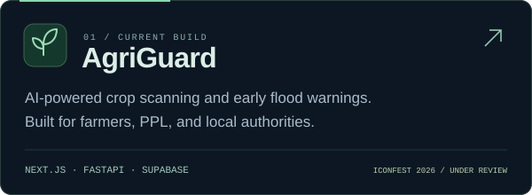
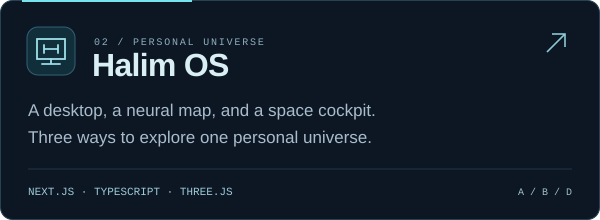
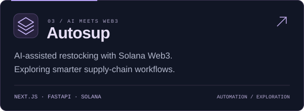
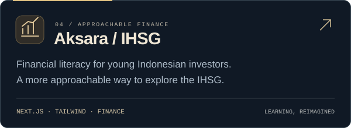

<p align="center">
  
</p>

<p align="center">
  <a href="https://abdulhalim.vercel.app"></a>
  <a href="https://www.linkedin.com/in/abdulhalim-dev/"></a>
  <a href="mailto:halimjunior52@gmail.com"></a>
</p>

## A little curiosity. A lot of building.

I'm **Abdul Halim**, a fifth-semester Informatics student at **Universitas Singaperbangsa Karawang (UNSIKA)** and **Google Student Ambassador ’26**.

I build full-stack web applications and connect them to real-world IoT systems. I enjoy working where thoughtful interfaces meet reliable backend logic — especially when technology can make someone's day a little easier.

```yaml
focus:       Full-Stack Web · IoT · Applied AI
building:    AgriGuard — ICONFEST 2026, preliminary round under review
exploring:   Blockchain · Solidity · Smart Contracts
open_to:     Internships · Web/IoT collaborations · Interesting ideas
based_in:    Karawang, Indonesia
```

## Selected builds

<table>
  <tr>
    <td width="50%">
      <a href="https://github.com/AbdulHalim26/agriguard"></a>
    </td>
    <td width="50%">
      <a href="https://github.com/AbdulHalim26/Portfolio-Website"></a>
    </td>
  </tr>
  <tr>
    <td width="50%">
      <a href="https://github.com/AbdulHalim26/autosup"></a>
    </td>
    <td width="50%">
      <a href="https://github.com/AbdulHalim26/project_ihsg"></a>
    </td>
  </tr>
</table>

<p align="center">
  One portfolio, three perspectives:<br />
  <a href="https://abdulhalim.vercel.app/desktop"><strong>A / Classic Desktop</strong></a>
  &nbsp;·&nbsp;
  <a href="https://abdulhalim.vercel.app/neural"><strong>B / Neural Map</strong></a>
  &nbsp;·&nbsp;
  <a href="https://abdulhalim.vercel.app/cockpit"><strong>D / Space Cockpit</strong></a>
</p>

## The tools behind the ideas

<p>
  
</p>

| Area | Working with |
| :--- | :--- |
| **Interfaces** | React, Next.js, TypeScript, Tailwind CSS |
| **Systems & data** | Node.js, PHP / Laravel, FastAPI, Supabase, PostgreSQL |
| **Connected things** | Web–IoT integration, telemetry, real-time monitoring dashboards |
| **Currently exploring** | Blockchain, Solidity, smart contracts |

## A few moments along the way

- **National finalist — ITechno Cup 2026**, Internet of Things competition, with team **Mindustry Waste** at Politeknik Negeri Jakarta.
- **Speaker — Seminar Nasional Digitalisasi Desa & UMKM 2026**, sharing the application of technology for village business digitalization at UNSIKA.
- **Exhibitor — PEKAN IT 2026**, exploring collaboration between people and AI.
- **Google Student Ambassador ’26**, October 2026–January 2027.

---

<p align="center">
  <strong>Have something useful in mind?</strong><br />
  <a href="mailto:halimjunior52@gmail.com">Let's build it together.</a>
  <br /><br />
  <sub>Stay curious. Keep building.</sub>
</p>
